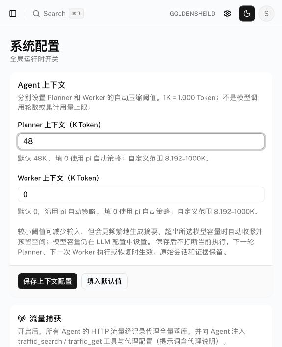

# Planner / Worker 上下文优化：真实模型对照与发布验收

日期：2026-10-27。只使用本地合成资料、隔离数据库及独立数据目录。模型为用户配置的 DeepSeek Flash；密钥仅运行时读取，隔离配置在退出时清空。隔离验收未访问外部测试目标，未修改生产模型、并发或上下文配置。发布后原未暂停任务按已有调度恢复，其请求与隔离验收分开记录。

## 对照口径

- 基线运行产物：`c5795437`，原容量压缩；候选完整对照：`3a029c83`，Planner 48,000、Worker 64,000 Token 的工作上下文触发目标。后续 `60f6fb3f` 仅精简约束说明，`bcfb3582` 仅调整功能测试等待时间；不改变压缩算法。
- **64K 是实验中的 Worker 配置，生产默认仍为 0（pi 自动策略）**。Planner 默认 48K。阈值不是每次请求硬上限，也不是模型调用轮数上限。模型真实窗口仍为 258,000。
- 每组条件重复三次。缓存为供应商共享缓存，交替运行但不能清空；命中率按 `Σ缓存读取 / Σ输入总量` 计算，不能解释为完全受控的因果增益。
- 输入总量 = 未缓存输入 + 缓存读取 + 缓存写入；总 Token = 输入总量 + 输出。包含摘要、纠错及失败请求，不重复累加原生活动汇总。以唯一物理请求账本核对实际网络请求次数和平台聚合，全部最终样本 usage 完整。
- 请求 JSON 字节数与供应商 Token 分开记录；本报告不估算人民币费用，也不把字节缩小等同于账单同比下降。

## 真实自动任务：三次完整运行合计

任务通过正式 HTTP 创建入口，Goals 分阶段保存目标与约束，Planner 派出第一条意图；Worker A 读取本地样本（4、7、9）并保存 20 及随机校验标识；Planner 根据该事实派第二条意图；Worker B 向本地确认接口核对标识及结果并写事实；Planner 引用事实证明目标，任务自然 `done`。

| 条件 | 模型请求 | 输入总量 | 未缓存输入 | 缓存读取 | 输出 | 总 Token | 命中率 |
| --- | ---: | ---: | ---: | ---: | ---: | ---: | ---: |
| 优化前 | 66 | 550,429 | 132,253 | 418,176 | 25,275 | 575,704 | 75.97% |
| 优化后 | 59 | 459,702 | 101,686 | 358,016 | 24,139 | 483,841 | 77.88% |

总 Token 减少 **15.96%**；请求 JSON 合计 2,034,136 → 1,711,784 字节。这些短任务未触发压缩，差异包含图谱装配优化、工具纠错和模型非确定性，不能全部归因于压缩。

| 角色 | 优化前总 Token / 请求 | 优化后总 Token / 请求 | 优化前命中率 | 优化后命中率 |
| --- | ---: | ---: | ---: | ---: |
| Goals | 26,353 / 9 | 26,444 / 9 | 55.02% | 64.74% |
| Planner | 322,639 / 30 | 267,429 / 26 | 79.18% | 78.53% |
| Worker | 226,712 / 27 | 189,968 / 24 | 73.28% | 78.42% |

六个任务均验证：

- 只形成目标栏的一个目标，描述的背景标记不进入目标阶段模型输入；Goals 完成后才启动规划。
- 每任务恰好两条不同意图、两个正常完成的 Worker，各两个事实；每个本地接口恰好请求一次，无重复派单、重复执行。
- Worker 尚未返回时事实已能查询；第二条意图晚于第一 Worker 退出，带有第一条事实的 `derived_from` 关系；事实保留资产锚点。
- 已保存事实、目标证据、原始会话可读取；自然结束后不再产生模型请求。
- 优化后第 2 个正式样本曾把 goal 节点作为事实依据，宿主拒绝一次 `add_intent`，模型随后正确重试并自然结束。它计入全部成本，未产生重复意图。不能表述为“所有工具调用零错误”；真实结果是 **1 次已纠正的参数校验失败，0 次未恢复错误**。

## 固定长历史与恢复：三次对照合计

每次包含 Planner、Worker 各一份确定性原生 pi 长历史，原始序列化大小约 397 KB；每个角色再恢复同一 JSONL 执行三轮真实 DeepSeek 续读。种子历史由确定性模型创建，不混入真实计量。上下文包含实际落库事实、负面结论、数值和固定核对标识；续读工具只有 `context_get`，不具备探测或写入能力。

| 条件 | 模型请求 | 摘要请求 | 输入总量 | 未缓存输入 | 缓存读取 | 输出 | 总 Token | 命中率 |
| --- | ---: | ---: | ---: | ---: | ---: | ---: | ---: | ---: |
| 原容量压缩 | 25 | 0 | 1,503,435 | 362,699 | 1,140,736 | 4,552 | 1,507,987 | 75.88% |
| 工作上下文 | 32 | 6 | 45,350 | 13,094 | 32,256 | 9,311 | 54,661 | 71.13% |

包含摘要成本后总 Token 减少 **96.38%**；请求 JSON 合计 9,980,582 → 164,481 字节。缓存命中率下降约 4.75 个百分点，说明压缩不保证缓存比例上升。摘要及恢复增加了请求数和输出量，但本合成长历史的输入节省远大于这些开销。

| 角色 | 优化前总 Token / 请求 | 优化后总 Token / 请求 | 优化前命中率 | 优化后命中率 |
| --- | ---: | ---: | ---: | ---: |
| Planner | 723,630 / 12 | 24,778 / 15 | 74.90% | 70.33% |
| Worker | 784,357 / 13 | 29,883 / 17 | 76.77% | 71.77% |

所有恢复保留 session ID 和 JSONL 原始前缀，原图节点不变；每个角色首次续读读取真实 fact，三轮均正确保留核对标识。优化后每个角色每份历史发生一次原生压缩。详细证据仍由引用展开，无历史工具重放。

该夹具含大量重复工具正文，收益不能推广为所有长任务都减少 96%。摘要由模型生成，不能证明任意自然语言信息永远无损；本次能证明的是被断言的事实、负面结论、核对标识及原始可展开证据在恢复后仍存在。

## 本轮修复与功能提交

| 提交 | 修复与证据 |
| --- | --- |
| `be848dfb` | `record_fact` 返回实际节点 `ref/version`，幂等重试返回当前内容版本；`add_intent` 明确节点版本与回执格式版本区别。回归覆盖内容版本 0、误传格式版本 1 被拒绝、父事实由宿主绑定版本和无重复事实。 |
| `d81bfb6f` | 约束工具明确单个完整原文段落，不拼接多个段落，不将真实换行变为字面量。回归保留否定、例外和事务原子性。 |
| `60f6fb3f` | 精简同一约束说明，保留上述语义，使四类长角色正文仍满足合计压缩至少 50% 的既有门槛。自定义正文不覆盖。 |
| `7e29b9bc` | 恢复故障注入只终止实际持有目标 advisory lock 的连接，避免误杀已释放连接后测试悬挂。冷图完成等待保留断言并增加调度余量。 |
| `bcfb3582` | 两项黑板生命周期测试等待从 12 秒改为 30 秒；覆盖开始、最终写回、补位与自然结束。不是放宽产品延迟指标，生产调度代码未改。 |
| `3a029c83` | 提交真实自动任务及长历史对照脚本，可指定独立编译运行版本，限制到本地证据并保存物理请求账本。 |
| `3a89309e` | 浏览器复核修复旧设置展示：不再挂载已退役 HTTP Auth 卡片；后端缺少 Shell 探测字段时显示未提供信息，并禁用无效保存，不伪报执行器探测失败。 |

原有优化及配置功能提交见 [前一轮报告](planner-token-optimization-20261027.md)，本次一并发布；上下文配置后端 `27122341`、系统配置 UI `d06cef12`。

## 计量及验收可追溯性

[机器可读验收摘要](evidence/context-budget-20261027/live-summary.json) 保存每份样本的数据库、原始记录路径、时间线、意图/事实、因果断言、角色用量及压缩/恢复记录。隔离数据库和原始 `/tmp/fate-context-*.json` 保留，隔离模型配置密钥已清空。所有数字与平台统一聚合逐一核对。

本轮隔离验收真实请求共 **227 次**：最终对照 182 次，探索和夹具修正 45 次。后者总 Token 354,497，单列而不伪装为通过样本；包括较早的版本参数误用、约束引用误用、计量导出字段/来源过滤修正。候选自动任务有一次已恢复参数拒绝，原始脚本最初把任何工具错误判为失败；最终评估只接受白名单内、之后有同工具成功回执且全链路断言通过的校验纠错，不忽略执行或连接错误。

第一次完整回归因故障注入连接选择问题主动终止，不计通过。随后一次 697 项运行中有 2 项失败（提示词体积、12 秒启动等待）；修复后重新运行完整回归。最终测试与发布结果将在下面记录。

## 最终回归与发布

| 检查 | 最终结果 |
| --- | --- |
| 完整服务端回归 | **77 个文件通过，696 项通过、1 项跳过**，一次完整运行全绿，626.52 秒 |
| 前端相关回归 | 上下文配置、模型用量、任务模型配置共 **10 项通过、0 跳过** |
| 类型检查 | 最终服务端与前端均通过 |
| 正式构建 | 后端通过；Next.js webpack 正式构建通过。默认 Turbopack 首次构建拒绝工作区外的依赖软链接，改用项目支持的 webpack 构建；未把失败构建计为通过 |
| 浏览器 | 正式系统配置为 Planner 48K、Worker 0；8K 非法值禁止保存，恢复原值且没有提交修改。退役卡片不再请求 404，缺失 Shell 诊断不再显示未知失败；任务 #4855 实时连接、Goals/Planner 历史及轮次分隔线正常 |

唯一跳过项为隔离库未配置真实模型的既有可选集成测试，不能算通过；真实 DeepSeek 证据由上述独立脚本提供。全量日志 `/tmp/fate-context-release-green-tests.log`；前端日志 `/tmp/fate-context-web-final-tests.log`。本轮未重新执行 30 分钟并发压测或完整八入口流式时序基准，不以本次页面检查替代这些测试。

发布于北京时间 **16:08**：确认 Worker、Planner、会话执行租约均为空后向旧后端发送 SIGTERM；退出后任务租约、会话租约、角色租约和 Worker 槽位均为 0。备份数据库、数据目录、配置和 JWT 密钥，随后启动后端、代理和正式前端。旧产物保留。

- 后端版本：`series-bcfb3582-production`，PID `38098`，`127.0.0.1:8787`；代理 `127.0.0.1:8788`。
- 后端产物：`/Users/pphua/.local/share/fate/releases/20261027-160518-bcfb3582`。
- 最终前端：`3a89309e`，PID `39022`，`http://localhost:5173`；16:15 仅切换前端以修正旧设置展示，没有再次中断后端。
- 前端产物：`/Users/pphua/.local/share/fate/releases/20261027-161329-3a89309e`，Build ID `HyJVVicbIqqKLyKmhQ2AS`。
- 备份：`/Users/pphua/.local/share/fate/backups/20261027-160518-bcfb3582`，敏感文件仅存本机，不入 Git。

[发布核对记录](evidence/context-budget-20261027/release-check.json) 包含健康版本、监听进程、停止时租约、配置和浏览器断言。暂停状态与原配置保留，#4855、#4858 未产生新请求。原未暂停的 #4849、#4852、#4857 自动恢复已有调度；截至核对共 30 次生产请求，**不属于 227 次隔离验收请求，也不混入成本对照**。#4857 随后为 done，其生产执行质量不据此并入合成样本结论。最终前端切换后的已观测后端日志无新增错误。

回退时可先将角色上下文设为 0，或在执行器安全退出后启动保留的旧发布目录；不要通过恢复旧数据库或删除新增会话/证据来回退。前端和后端各自的发布清单记录前一产物路径。现有依赖链接、生成配置和其他未提交内容保持原样；本轮按功能提交，未推送远程。

## REVIEW 与回退

- pi 仍负责模型和工具循环、压缩边界及 JSONL 持久化；宿主未裁剪会话数组或重放目标操作。
- 摘要请求使用同一模型解析和计量链；累计流 usage 以请求身份去重。本次完整请求包括摘要和纠错。
- Worker 边发现边写回保持有效；按需读取保留来源、版本和展开引用；精确重复意图仍由宿主去重，错误版本或错误类型的依据不放行。
- 缓存比例并非唯一成本指标。小工作集可显著减少总输入，也可能增加摘要、请求数或降低缓存比例；应观察完整任务总量和质量。
- 当前样本未覆盖七类角色的所有真实模型路径，也不是高并发性能压测；这部分仍以确定性回归为证据，不宣称做过本轮真实并发验收。
- 上下文策略可在系统配置中将相应角色设为 0，在下一次对应 runner 创建/恢复时回到 pi 容量策略。配置变更不打断当前执行。代码可按功能提交 `git revert`，回退不删除账本、JSONL、图谱或证据。
